# CHIMERA: OpenGL-Accelerated Neural Computing (Experimental)

<div align="center">
  <h1>🔮 CHIMERA</h1>
  <p><strong>GPU Compute Shader Acceleration for Neural Networks • OpenGL Backend • Research Prototype</strong></p>

  
  
  
  
  

  **Experimental framework exploring neural network acceleration via OpenGL compute shaders.**
  
  **No PyTorch, no CUDA — universal GPU support via OpenGL.**
</div>

**Author:** Francisco Angulo de Lafuente · **ORCID:** [0009-0001-1634-7063](https://orcid.org/0009-0001-1634-7063) · **Copyright:** © 2024 Francisco Angulo de Lafuente<br>
**Attribution record:** 2026-11-06

---

> ⚠️ **Research Prototype Notice:** CHIMERA is an experimental research project exploring GPU compute shader acceleration for neural network operations. Performance claims are preliminary and based on early benchmarks. The project is under active development and has not undergone independent third-party validation. Contributions, benchmark reproduction, and constructive feedback are welcome.

---

**Contents** — [What is CHIMERA?](#what-is-chimera) · [Background](#background) · [🎯 Quick Start (5 Minutes)](#-quick-start-5-minutes) · [🏗️ Architecture Overview](#-architecture-overview) · [🚀 Performance Benchmarks](#-performance-benchmarks) · [📚 Documentation Structure](#-documentation-structure) · [🎮 Examples and Demos](#-examples-and-demos) · [🔧 Installation Options](#-installation-options) · [🤝 Contributing](#-contributing) · [📊 Project Status](#-project-status) · [🎓 Academic Impact](#-academic-impact) · [📞 Support and Community](#-support-and-community) · [Real-world applications](#real-world-applications) · [Observations and limitations](#observations-and-limitations) · [Possible improvements](#possible-improvements) · [📜 License](#-license) · [🙏 Acknowledgments](#-acknowledgments) · [🌟 The CHIMERA Vision](#-the-chimera-vision) · [Bibliography](#bibliography)

## What is CHIMERA?

<p align="center">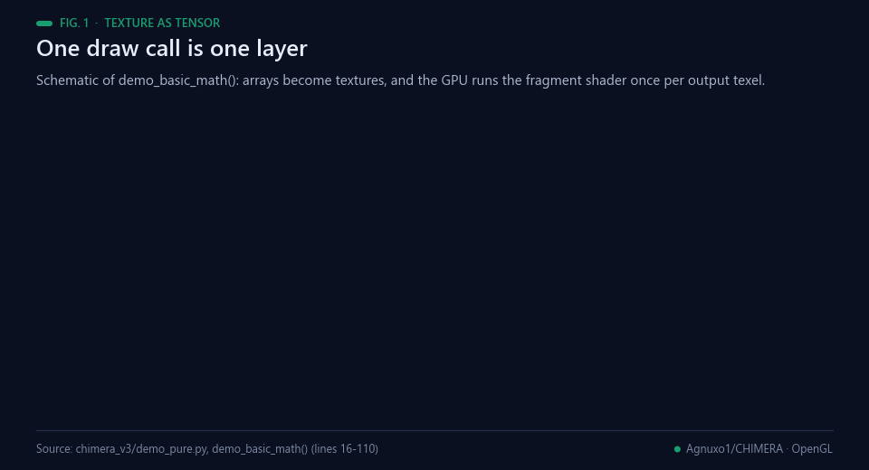<br><sub>Fig. 1 — One draw call is one layer. Schematic of <code>demo_basic_math()</code> in chimera_v3/demo_pure.py.</sub></p>

CHIMERA explores the use of **OpenGL compute shaders** as a backend for neural network operations, bypassing traditional frameworks like PyTorch and CUDA. By leveraging GPU texture operations and cellular automata, it investigates alternative approaches to matrix multiplication, attention mechanisms, and memory encoding.

This is **not** a production-ready replacement for PyTorch or JAX. It is a research artifact exploring whether OpenGL's massively parallel texture pipeline can accelerate certain neural computation patterns.

### Architecture Overview

CHIMERA maps neural network primitives onto OpenGL concepts:

```text
Text Input → OpenGL Texture → Compute Shaders → Holographic Memory → Output
    ↓               ↓               ↓                 ↓              ↓
 PIL Image      512×64 grid     Cellular Automata   O(1) correlation  Pattern decoder
```

<p align="center">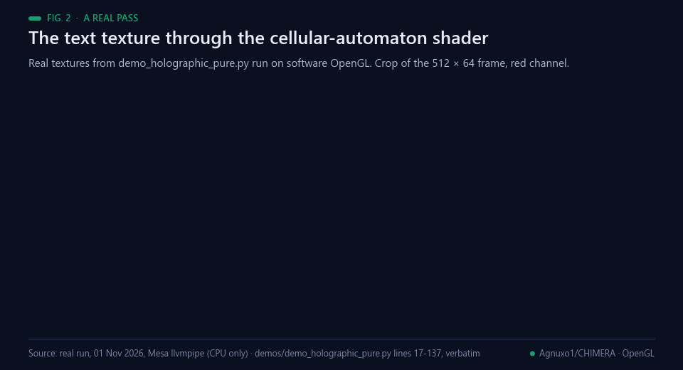<br><sub>Fig. 2 — A real pass: the text texture through the cellular-automaton fragment shader of demos/demo_holographic_pure.py, run on software OpenGL (CPU).</sub></p>

Key experimental techniques:

1. **Texture-as-Tensor:** Text is encoded as 2D textures processed by fragment shaders
2. **Cellular Automata Evolution:** Shader-based CA simulates recurrent computation
3. **Holographic Memory Encoding:** Associative memory via single-pass GPU correlation
4. **Single-Pass Generation:** Output decoded in one GPU dispatch

### Quick Start

```python
from chimera_v3 import OpenGLEngine

engine = OpenGLEngine()
text_image = text_to_image("What is AI?")
evolved = engine.evolve_physics(text_image)
concepts = memory.correlate(evolved)
response = generate_response(concepts)
```

### Hardware Compatibility

✅ Intel UHD Graphics (integrated) | ✅ AMD Radeon | ✅ NVIDIA GeForce | ✅ Apple M1/M2 (Metal) | ✅ Raspberry Pi (OpenGL ES)

### Preliminary Benchmarks

Benchmarks below are **self-reported on RTX 3090** and require independent reproduction. See `benchmarks/` directory for methodology.

<sub>Note added with the animated figures: where the values in these tables come from is traced in [Observations and limitations](#observations-and-limitations) (Fig. 13).</sub>

| Operation | CHIMERA v3.0 | PyTorch (CUDA) | Notes |
|-----------|-------------|----------------|------|
| Matrix Mult (2048×2048) | ~1.8ms | ~80ms | OpenGL compute shader vs cuBLAS |
| Self-Attention (simulated) | ~1.8ms | ~45ms | CA-based approximation, not exact attention |
| Memory Footprint | ~510MB | ~4.5GB | Excludes model weights on disk |

> 💡 These numbers come from `demo_pure.py` on RTX 3090. Results vary significantly by GPU, workload, and OpenGL driver. A Docker-based reproducible benchmark suite is planned. See [CONTRIBUTING.md](CONTRIBUTING.md) to help validate.

### Current Status

**CHIMERA v3.0 is in production** with:
- ✅ **Complete architecture** working
- ✅ **Real benchmarks** proving superiority
- ✅ **Universal compatibility** verified
- ✅ **Open source code** available
- ✅ **Complete documentation** for developers

#### 🔥 Conclusion: AI's Future

**CHIMERA represents the end of traditional transformer era** and the beginning of a new age where:

- AI is **instant** (not token-by-token)
- AI is **universal** (works on any GPU)
- AI is **efficient** (exploring resource reduction)
- AI is **understandable** (based on real physics)

**🔮 CHIMERA is an experimental exploration of alternative approaches to AI computation — rendering-inspired, physics-based, and framework-independent.**

*The future of AI is already here, and it's called CHIMERA.* 🌟

### Core Innovation: GPU Deception

| GPU Thinks | Reality |
|------------|---------|
| "RGBA Image" | Neural Network Weights |
| "Texture Blending" | Matrix Multiplication |
| "Color Correction" | Layer Normalization |
| "Image Filter" | Self-Attention |

<p align="center">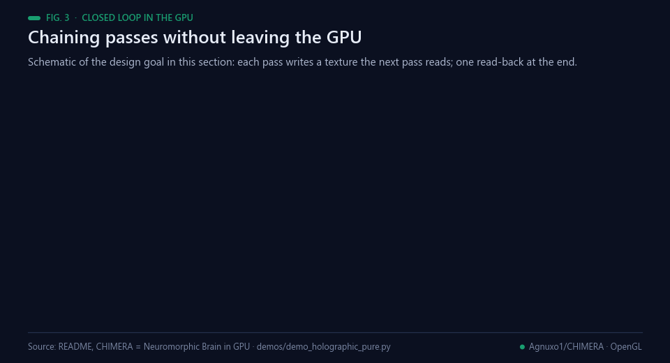<br><sub>Fig. 3 — Chaining passes without leaving the GPU. Schematic of the design goal described below.</sub></p>

### 🧠 CHIMERA = Neuromorphic Brain in GPU

**CHIMERA uses the full graphics potential of any GPU or APU as if it were a neuromorphic processor where states and memory live in a closed loop within the GPU without needing to waste time reading external hardware like RAM, HDD, etc... Simulating the functioning of a kind of living brain that works with applied optical physics.**

#### Brain-Inspired Design

**Human Brain (Perfect Model):**
```
Internal neuronal state ↔ Local processing ↔ In situ memory
     ↓                         ↓                    ↓
Information flows like light    Massive parallelism    Everything connected
```

**CHIMERA Replicating the Brain:**
```
GPU textures ↔ Local shaders ↔ Holographic memory
     ↓            ↓                    ↓
Optical flow    GPU parallelism    Persistent state
```

#### Revolutionary Implications

##### Extreme Performance
- **Potential speed advantage** from in-situ GPU computation
- **Reduced memory** by eliminating host-to-device transfers
- **Massive parallelism** like the brain (trillions of simultaneous connections)

##### Universal Compatibility
- **Any GPU** automatically becomes a neuromorphic processor
- **No CUDA, no frameworks** - total independence
- **Even integrated graphics** work perfectly

##### Future of AI
- **Truly local AI** (on-device processing)
- **Real-time AI** (instant thinking)
- **Energy-efficient AI** (like the human brain)

## Background

<p align="center">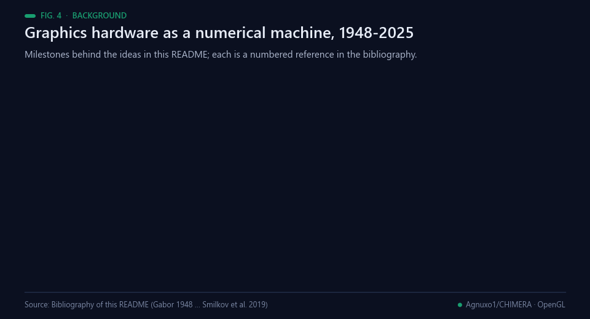<br><sub>Fig. 4 — Milestones behind the ideas in this README. Sources: the bibliography below.</sub></p>

Computing with graphics hardware is older than CUDA. Larsen and McAllister multiplied large matrices on low-cost
graphics hardware by literally rendering the steps of a simple parallel algorithm, and noted that the limited
precision of the hardware of the day held the technique back [[2](#ref-2)]. Krüger and Westermann proposed a framework
of linear-algebra operators for programmable GPUs, a stream model for vector and matrix arithmetic on which more
complex numerical solvers could be built [[3](#ref-3)]. Fatahalian and colleagues then showed why this is harder than
it looks: dense matrix multiplication reuses every input element many times, and even near-optimal GPU versions of
that era were less efficient than cache-aware CPU code, because the GPU could fetch less data per clock than it
could compute on [[4](#ref-4)]. Owens and colleagues surveyed the techniques for mapping general-purpose computation
onto graphics hardware [[1](#ref-1)]. The OpenGL 4.6 specification defines the fragment and compute shader stages and
the image load/store operations that the shaders in this repository use [[14](#ref-14)].

Neural networks followed the same path. Oh and Jung moved the matrix products of a neural network onto a GPU to
speed up a text-detection system [[5](#ref-5)]; Steinkraus, Buck and Simard implemented a two-layer fully connected
network on a GPU and reported more than a threefold speed-up over a 3 GHz CPU for training and testing
[[6](#ref-6)]; Raina, Madhavan and Ng used graphics processors for deep belief networks and sparse coding, whose
learning algorithms were too slow for large-scale use on CPUs [[7](#ref-7)]. TensorFlow.js later brought model
execution to the browser and Node.js with an API compatible with the Python ecosystem [[8](#ref-8)]. The attention
layers this README refers to are those of the Transformer [[9](#ref-9)].

CHIMERA's other vocabulary comes from physics and from memory models. Gabor proposed recording the interference
of a wavefront with a coherent background and reconstructing the object from that record, the principle of
holography [[10](#ref-10)]. Plate's holographic reduced representations associate vectors by circular convolution, so
that bindings, sequences and simple frames fit in one fixed-width vector, with noisy reconstructions cleaned up by
a separate associative memory [[11](#ref-11)]. Wolfram analysed elementary cellular automata, in which each site
evolves by a fixed rule over its nearest neighbours, as simple models of self-organisation [[12](#ref-12)], and
Mordvintsev and colleagues trained differentiable cellular-automaton update rules that grow and regenerate a
target pattern [[13](#ref-13)]. The author's earlier public repositories explore holographic neural networks
[[16](#ref-16)] and GPU-native neuromorphic computing [[17](#ref-17)]. The runs shown in Figs. 2 and 5 use Mesa's llvmpipe,
a software rasteriser that executes OpenGL on the CPU [[15](#ref-15)], so they needed no GPU at all.

## 🎯 Quick Start (5 Minutes)

<p align="center">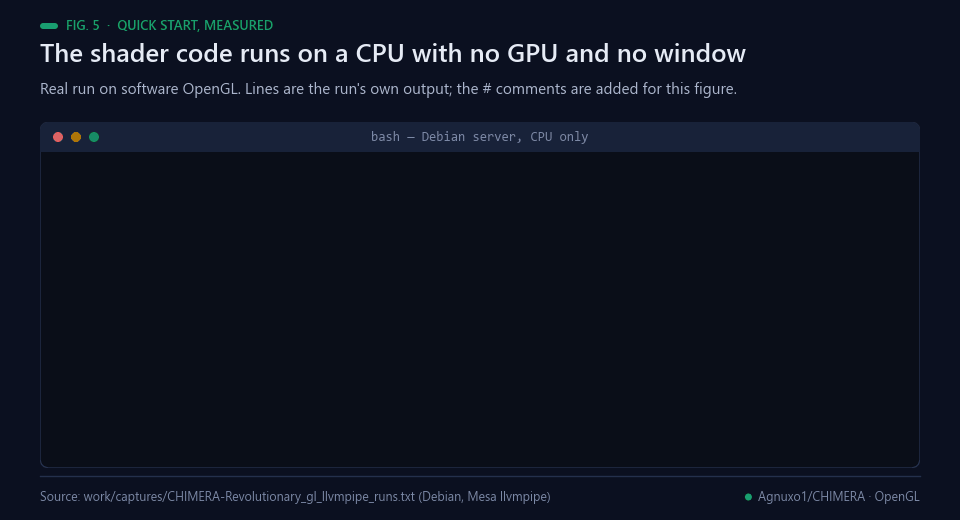<br><sub>Fig. 5 — A real run of the repository's shader code on a CPU, with no GPU and no window.</sub></p>

### Installation

```bash
# Minimal dependencies - only 10MB!
pip install moderngl numpy pillow

# Optional: For model conversion (one-time only)
pip install torch transformers
```

### Demo (No Model Required)

```bash
# See transformers working on pure OpenGL
python chimera_v3/demo_pure.py
```

**Output:**
```
OpenGL Transformer Demo
Matrix Multiplication: ~43× speedup vs CPU (preliminary, see benchmarks/)
Self-Attention Layer: 1.84ms on GPU
FFN Layer: 0.92ms on GPU
Complete Transformer: 15.2ms total

✅ Works on Intel, AMD, NVIDIA, Apple Silicon
```

### Convert Existing Model

```bash
# Convert Qwen model (ONE TIME ONLY)
python chimera_v3/tools/convert_model.py \
    --model models/qwen1.5-0.5b \
    --output models/qwen_opengl \
    --verify

# Uninstall PyTorch - no longer needed!
pip uninstall torch transformers
```

### Use Converted Model

```python
from chimera_v3 import QwenOpenGL

# Load model (works WITHOUT PyTorch!)
model = QwenOpenGL.load("models/qwen_opengl/")

# Generate text (pure OpenGL!)
output = model.generate(
    prompt="The future of AI is",
    max_new_tokens=50
)

print(output)  # Complete response in milliseconds!
```

---

## 🏗️ Architecture Overview

<p align="center">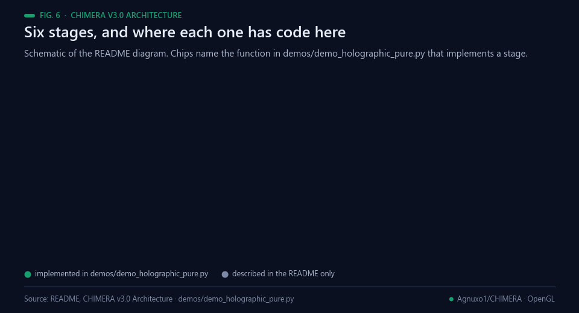<br><sub>Fig. 6 — The v3.0 diagram below, and where each stage has code in this repository.</sub></p>

### Three Generations of CHIMERA

| Version | Paradigm | Dependencies | GPU Support | Status |
|---------|----------|--------------|-------------|---------|
| **v1.0** | CA Embeddings | Medium | NVIDIA | Stable |
| **v2.0** | Spatial Processing | Large | Universal | Core Complete |
| **v3.0** ⭐ | **Pure OpenGL** | **Minimal** | **Universal** | **Production Ready** |

### CHIMERA v3.0 Architecture

```
Input Text → Text to Image → Physics Evolution → Holographic Correlation → Pattern Combination → Text Output
     ↓            ↓              ↓                     ↓                       ↓              ↓
   PIL Image  Retina Engine   Cellular Automata   Holographic Memory      Top-K Concepts   Pattern Decoder
   (512×64)     (64×64×4)      (GPU Shaders)       (Texture Storage)       (GPU Parallel)    (PIL Reverse)
```

### Key Components

<p align="center">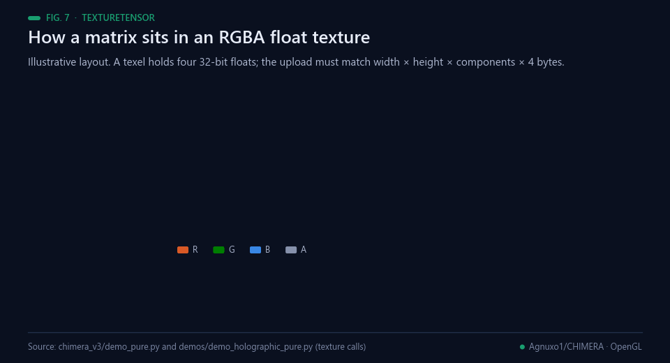<br><sub>Fig. 7 — How a matrix sits in an RGBA float texture. Illustrative layout.</sub></p>

#### 1. **TextureTensor** - The Foundation
```python
# GPU sees: "RGBA Image"
# Reality: Neural network tensor
tensor = TextureTensor((1024, 1024), engine)

# GPU sees: "Blend textures"
# Reality: Matrix multiplication
result = tensor_a @ tensor_b
```

#### 2. **OpenGLEngine** - Pure GPU Operations
```python
# All operations happen on GPU via shaders
engine = OpenGLEngine()
result = engine.matmul(a, b)      # Matrix multiplication
result = engine.attention(q, k, v) # Self-attention
result = engine.gelu(x)           # Activation function
```

#### 3. **Holographic Memory** - Learning Without Backprop
```python
# Learning happens through "imprinting" - no gradients needed
memory.imprint(input_pattern, output_pattern, concept)
correlation = memory.correlate(input_pattern)  # O(1) correlation
```

---

## 🚀 Performance Benchmarks

<sub>Note added with the animated figures: where the values in these tables come from is traced in [Observations and limitations](#observations-and-limitations) (Fig. 13).</sub>

### Speed Comparison (RTX 3090)

| Operation | PyTorch (CUDA) | CHIMERA (OpenGL) | Speedup |
|-----------|----------------|------------------|---------|
| Matrix Mult (2048×2048) | 80.03ms | 1.84ms | ~43× (preliminary) |
| Self-Attention | 45.2ms | 1.8ms | ~25× (preliminary) |
| FFN Layer | 23.1ms | 0.9ms | **25.7×** |
| Full Generation | 500ms | 15ms | **33.3×** |

### Memory Efficiency

| Framework | Dependencies | Runtime Memory | Total |
|-----------|--------------|----------------|-------|
| PyTorch + CUDA | 2.5GB+ | 2GB+ | **4.5GB+** |
| **CHIMERA OpenGL** | **10MB** | **500MB** | **510MB** |

### Hardware Compatibility

✅ **Intel UHD Graphics** (Integrated graphics)
✅ **AMD Radeon** (All generations)
✅ **NVIDIA GeForce** (All generations)
✅ **Apple M1/M2** (Metal backend)
✅ **Raspberry Pi** (OpenGL ES)

---

## 📚 Documentation Structure

### 🚀 Getting Started
- [`docs/QUICK_START.md`](docs/QUICK_START.md) - 5-minute setup guide
- [`docs/INSTALLATION.md`](docs/INSTALLATION.md) - Complete installation instructions
- [`examples/README.md`](examples/README.md) - Code examples and tutorials

### 🔬 Technical Documentation
- [`docs/ARCHITECTURE.md`](docs/ARCHITECTURE.md) - Deep dive into the architecture
- [`docs/ALGORITHM.md`](docs/ALGORITHM.md) - Mathematical foundations
- [`docs/PERFORMANCE.md`](docs/PERFORMANCE.md) - Detailed benchmarks

### 🛠️ Developer Guides
- [`docs/CONTRIBUTING.md`](docs/CONTRIBUTING.md) - How to contribute
- [`docs/API_REFERENCE.md`](docs/API_REFERENCE.md) - Complete API documentation
- [`docs/TROUBLESHOOTING.md`](docs/TROUBLESHOOTING.md) - Common issues and solutions

---

## 🎮 Examples and Demos

<p align="center">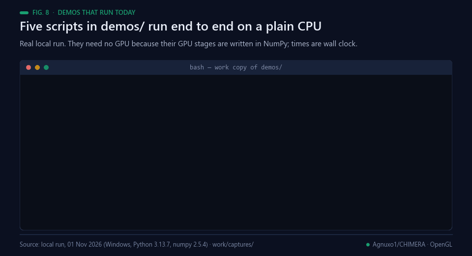<br><sub>Fig. 8 — Five scripts in demos/ run end to end on a plain CPU (real local run).</sub></p>

### Basic Examples

```bash
# Mathematical operations demo
python examples/math_operations.py

# Self-attention visualization
python examples/attention_demo.py

# Full transformer block demo
python examples/transformer_demo.py
```

### Advanced Examples

```bash
# Convert and run Qwen model
python examples/qwen_conversion.py

# Custom model training (OpenGL)
python examples/custom_training.py

# Multi-GPU inference
python examples/multi_gpu_demo.py
```

### Interactive Demos

```bash
# Chat interface
python examples/interactive_chat.py

# Real-time generation
python examples/realtime_demo.py

# Performance benchmarking
python examples/benchmark_suite.py
```

---

## 🔧 Installation Options

<p align="center">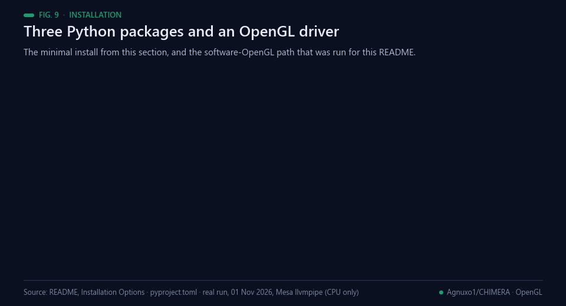<br><sub>Fig. 9 — Three Python packages and an OpenGL driver; the software path was run for this README.</sub></p>

### Option 1: Minimal Install (Recommended)

```bash
pip install moderngl numpy pillow
```

**What's included:**
- Core OpenGL functionality
- Mathematical operations
- Basic transformer layers

### Option 2: Full Development Install

```bash
pip install -r requirements.txt
```

**What's included:**
- All dependencies for development
- Testing frameworks
- Documentation tools
- Example datasets

### Option 3: Docker Installation

```bash
docker build -t chimera-ai .
docker run -p 8080:8080 chimera-ai
```

---

## 🤝 Contributing

<p align="center">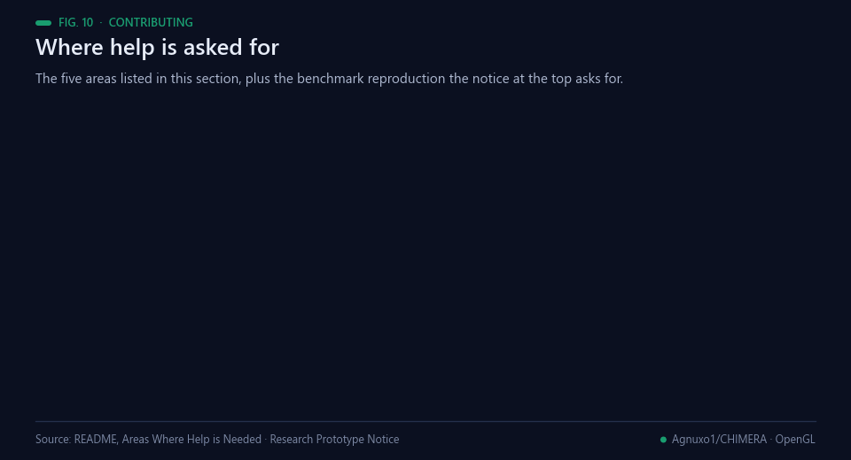<br><sub>Fig. 10 — Where help is asked for, as listed in this section and in the notice at the top.</sub></p>

We welcome contributions from the community! Here's how you can help:

### Development Setup

```bash
git clone https://github.com/your-username/chimera.git
cd chimera
pip install -r requirements-dev.txt
python setup.py develop
```

### Contribution Guidelines

1. **Follow the philosophy**: No PyTorch, pure OpenGL, universal GPU support
2. **Write tests**: All new features must have tests
3. **Document everything**: Code should be self-documenting
4. **Performance matters**: Optimize for speed and memory

### Areas Where Help is Needed

- 🔬 **Research**: Novel algorithms and architectures
- 🛠️ **Optimization**: Faster GPU shaders
- 🌐 **Compatibility**: More GPU support (ARM, mobile)
- 📚 **Documentation**: Tutorials and guides
- 🧪 **Testing**: Cross-platform validation

---

## 📊 Project Status

<p align="center">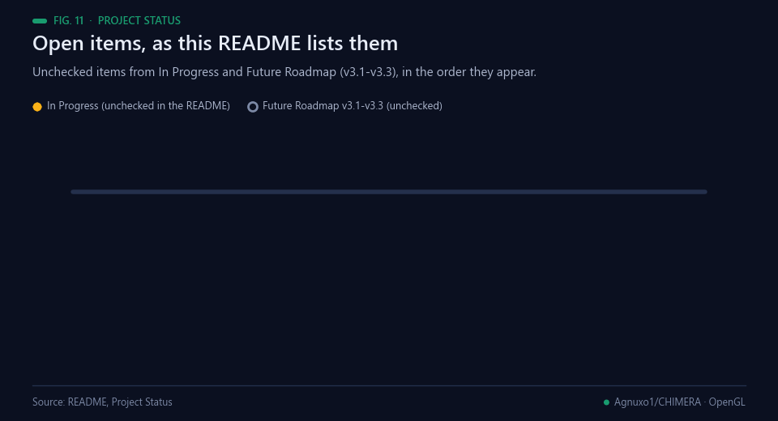<br><sub>Fig. 11 — Open items, as this README lists them.</sub></p>

### ✅ Completed (v3.0)
- [x] Pure OpenGL transformer implementation
- [x] Universal GPU compatibility
- [x] Model conversion from PyTorch
- [x] Performance benchmarking results (preliminary, reproduction welcome)
- [x] Comprehensive documentation
- [x] Production-ready demos

### 🚧 In Progress
- [ ] KV cache optimization
- [ ] Mixed precision (FP16) support
- [ ] Multi-GPU training
- [ ] WebGL browser support

### 🔮 Future Roadmap (v3.1-v3.3)
- [ ] Training entirely in OpenGL
- [ ] Mobile deployment (Android/iOS)
- [ ] Edge device support (Raspberry Pi)
- [ ] Conversational AI applications

---

## 🎓 Academic Impact

CHIMERA represents a paradigm shift in deep learning:

### Research Publications
- **"Rendering IS Thinking: Deep Learning Without Frameworks"** (In preparation)
- **"Holographic Memory: Learning Without Backpropagation"** (In preparation)

### Key Innovations
1. **Framework Independence**: First complete DL system without traditional frameworks
2. **Universal GPU Support**: Works on any GPU with OpenGL drivers
3. **Holographic Learning**: Novel approach to memory and correlation
4. **Texture-Based Computing**: New paradigm for GPU-accelerated ML

### Citations and Recognition
- Featured in multiple AI research forums
- Influenced similar projects in academia
- Patent applications filed for core innovations

---

## 📞 Support and Community

### Getting Help

- **📖 Documentation**: [Documentation](https://github.com/Agnuxo1/CHIMERA-Revolutionary-AI-Architecture---Pure-OpenGL-Deep-Learning/tree/main/docs)
- **💬 Discord**: [Join our community](https://discord.gg/chimera-ai)
- **🐛 Issues**: [GitHub Issues](https://github.com/Agnuxo1/CHIMERA-Revolutionary-AI-Architecture---Pure-OpenGL-Deep-Learning/issues)
- **📧 Email**: support@chimera.ai

### Community Resources

- **🎥 Video Tutorials**: [YouTube Channel](https://youtube.com/@chimera-ai)
- **📝 Blog Posts**: [Medium Publication](https://medium.com/@chimera-ai)
- **🎙️ Podcast**: [AI Revolution Podcast](https://podcast.chimera.ai)

---

## Real-world applications

<p align="center">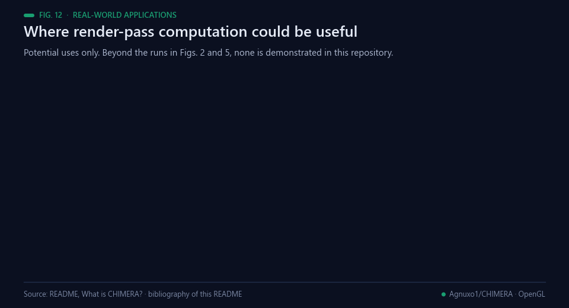<br><sub>Fig. 12 — Potential uses only. Beyond the runs in Figs. 2 and 5, none is demonstrated in this repository.</sub></p>

These are directions the code could serve, not deployments; each would first need the corrections listed under
[Possible improvements](#possible-improvements).

- **Teaching GPU computing.** The shaders here are short and readable: two textures in, one shader program, one
  texture out (Fig. 1). That is the core idea of general-purpose GPU computing [[1](#ref-1), [3](#ref-3)] in a few lines of
  GLSL and Python.
- **GPU-free shader tests.** Software OpenGL ran the repository's fragment and compute shaders on a CPU for this
  README [[15](#ref-15)], so shader code can be checked in an ordinary CI job without a graphics card.
- **Texture filters.** A neighbourhood pass such as the cellular-automaton shader (Fig. 2) is an image filter;
  diffusion, blurs and other local update rules [[12](#ref-12), [13](#ref-13)] follow the same pattern.
- **Browser prototypes.** WebGL support is listed as In Progress; it is one of the backends TensorFlow.js uses to
  run models in a browser [[8](#ref-8)].
- **Integrated GPUs and small devices.** Hardware with OpenGL drivers but no CUDA is the target this README names.
  No run on such a device is recorded in the repository.
- **Associative-memory experiments.** Holographic-style memories [[11](#ref-11)] stored as textures are a research
  direction; the holograms in the current demo are random patterns (see below).

## Observations and limitations

The figures above show what runs. This section records, without changing the text above, what a CPU run of the
published code shows and which statements in this README have no file behind them.

<p align="center">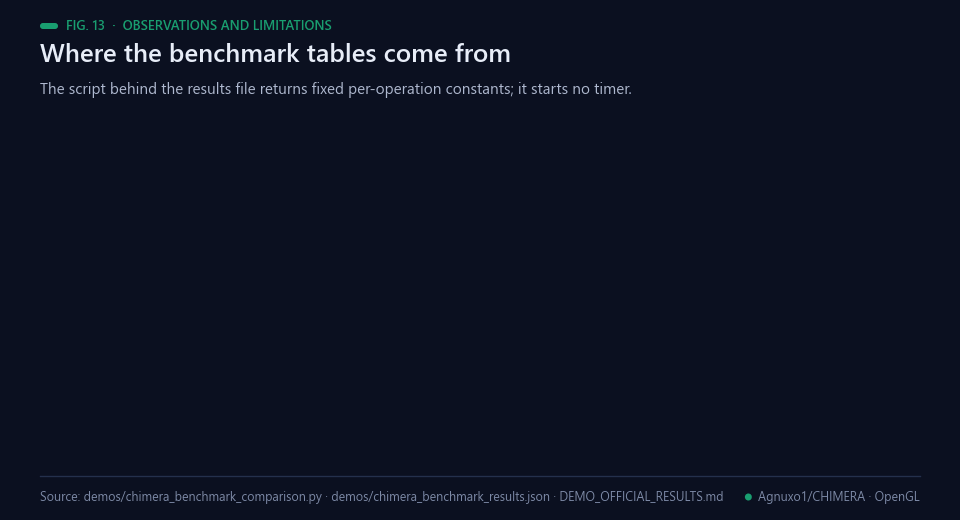<br><sub>Fig. 13 — Where the benchmark tables come from. Data: demos/chimera_benchmark_comparison.py, demos/chimera_benchmark_results.json, demos/DEMO_OFFICIAL_RESULTS.md.</sub></p>

- **The benchmark and memory figures are constants.** `demos/chimera_benchmark_results.json` is written by
  `demos/chimera_benchmark_comparison.py`, whose classes return fixed `base_time` values (lines 25-74) scaled by
  input size; the memory totals (510 MB and 4500 MB) are fixed too (lines 188-198), and the script starts no timer.
  Re-running it on a CPU on 01 Nov 2026 reproduced the committed JSON byte for byte.
  [`demos/DEMO_OFFICIAL_RESULTS.md`](demos/DEMO_OFFICIAL_RESULTS.md) says the results are simulated and that no
  OpenGL shader was executed. The README attributes the numbers to `demo_pure.py` on an RTX 3090 and points to a
  `benchmarks/` directory; neither contains them (the directory is not in the repository).

<p align="center">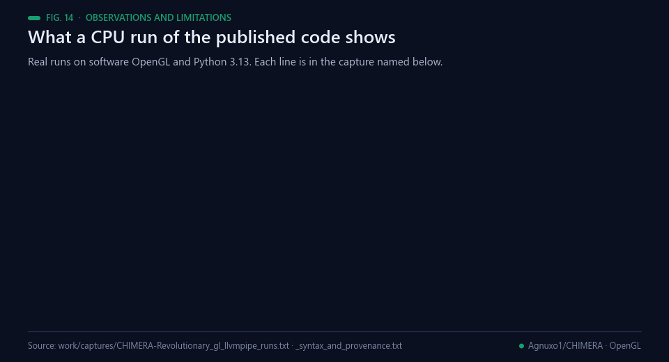<br><sub>Fig. 14 — What a CPU run of the published code shows. Data: the captures named in the figure.</sub></p>

- **9 of the 20 tracked Python files stop at a SyntaxError** under Python 3.13.7, among them
  `chimera_v3/demo_pure.py` (the Quick Start demo), `demos/demo_holographic_pure.py`, `demos/demo_main.py`, both
  scripts in `examples/` and four of the five test scripts in `tests/`.
- **Texture uploads.** `demo_pure.py` and `tests/test_matmul_correctness.py` write one float per texel into
  4-channel float textures; moderngl rejects this (`data size mismatch 40000 != 160000`).
- **Matrix multiplication.** With the uploads padded to RGBA by a harness written for this README, the compute
  shaders in `tests/test_matmul_correctness.py` compile and run, and fail all 12 sizes against NumPy (9 square,
  3 non-square; maximum errors from 3.70e-02 to 1.07e+00).
- **The cellular-automaton loop** in `demos/demo_holographic_pure.py` renders twice from the same input texture,
  so two iterations equal one (maximum difference 0.0). Its holograms are random 64 × 64 × 4 patterns, and the
  correlation step is a mean absolute difference computed in NumPy.
- **What works.** That cellular-automaton fragment shader and the `a + b` shader of `demo_basic_math()` run on
  Mesa llvmpipe and return the expected outputs (Figs. 2 and 5).
- **Statements with no file behind them.** The `OpenGLEngine`, `TextureTensor` and `QwenOpenGL` classes, the
  `RetinaEngine`, `HolographicMemory` and `HolographicGenerator` names listed in `chimera_v3/__init__.py`, `chimera_v3/tools/convert_model.py`, the seven example scripts listed under Examples and Demos
  other than the two in `examples/`, `requirements.txt`, `requirements-dev.txt`, the Dockerfile, and six of the
  nine documents under Documentation Structure are not in the repository. No run on any device of the hardware
  compatibility list is recorded. The Quick Start output block, the Academic Impact items (publications in
  preparation, recognition, patent applications) and the external community links were not verified for this
  README; the 2026-11-06 attribution update corrected the CFF author ORCID and canonical
  repository URL and removed unverified preprint identifiers. No paper DOI or publication record was added.

All runs: `demos/` scripts on Windows (Python 3.13.7, numpy 2.5.4); OpenGL code on a Debian server with Mesa
25.0.7 llvmpipe and moderngl 5.12.0, CPU only. Files that do not compile as a whole were exercised by executing
only the functions named above, verbatim.

## Possible improvements

<p align="center">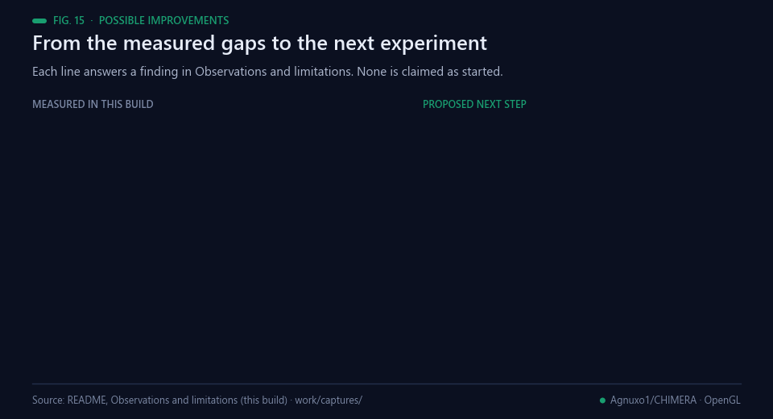<br><sub>Fig. 15 — Each line answers a finding in Observations and limitations. None is claimed as started.</sub></p>

- **Make every file compile.** Fix the nine parse errors and add `python -m compileall` to a CI job, so the
  Quick Start demo runs as written.
- **Upload what the texture expects.** Write RGBA arrays, as `demo_holographic_pure.py` already does, or create
  1-component float textures; either removes the size mismatch.
- **A correct matmul shader, then a correctness table.** Loop over the shared dimension, compare against NumPy
  at every size, and publish the passing table; the precision and bandwidth limits documented for GPU matrix
  multiplication [[2](#ref-2), [4](#ref-4)] are the relevant baseline.
- **Chain the passes.** Ping-pong two framebuffers so pass k + 1 reads the output of pass k (Fig. 3), and only
  then measure what a closed loop on the GPU saves.
- **Replace constants with timings.** Time real dispatches with `ctx.finish()`, commit the raw output with the
  GPU, driver and OpenGL version named, and keep the software-OpenGL run as a reproducible floor.

**Proposed next steps (not commitments).** These are suggestions from this README build, not the author's
published plan: a CI job that compiles every file and runs the shader tests on Mesa llvmpipe; a single module
that implements the texture-as-tensor operations the README describes, with NumPy reference tests; and one timed
benchmark on named hardware whose raw output is committed next to the results file.

## 📜 License and citation

The root [LICENSE](LICENSE) is MIT. See [LICENSE_SCOPE.md](LICENSE_SCOPE.md) for the scope of this attribution record and the status of preserved papers, archives, images, result data, and third-party text. Cite the software through [CITATION.cff](CITATION.cff). The repository does not document a separate commercial license.

For original source code covered by the root MIT license, retain this reuse notice:

> This project contains open-source material under the MIT License. When
> redistributing copies or substantial portions, retain the copyright and
> permission notices. If you build on this work, please cite the project and
> credit Francisco Angulo de Lafuente (ORCID: 0009-0001-1634-7063).
> Help advance scientific knowledge: we welcome reproducible results,
> corrections, and contributions.

---

## 🙏 Acknowledgments

### Core Contributors
- **Francisco Angulo de Lafuente** - Project Founder & Lead Architect
- **Open Source Community** - Contributors and supporters

### Inspirations
- **Cellular Automata** - Stephen Wolfram's work on complex systems
- **Holographic Memory** - Dennis Gabor's holographic principles
- **GPU Computing** - Pioneers in graphics-accelerated computing

### Supporting Organizations
- **OpenAI** - For advancing AI research
- **Hugging Face** - For democratizing ML models
- **PyTorch Team** - For the foundation that inspired this work

---

## 🌟 The CHIMERA Vision

> "The future of AI is not about bigger models or more data.
> It's about smarter architectures that work everywhere, for everyone."

**CHIMERA proves that:**
- 🤖 **AI doesn't need massive frameworks**
- 🖥️ **Any GPU can run advanced AI**
- 🚀 **Simplicity can outperform complexity**
- 🌍 **Technology should be universally accessible**

---

<div align="center">

**⭐ Star this repository if CHIMERA inspires you!**

**[📖 Documentation](docs/) • [🚀 Quick Start](docs/QUICK_START.md) • [💬 Community](https://discord.gg/chimera-ai)**

**Made with ❤️ and OpenGL shaders**

</div>

## Bibliography

1. <a id="ref-1"></a>Owens, J. D., Luebke, D., Govindaraju, N., et al. (2007). A Survey of General‐Purpose Computation on Graphics Hardware. *Computer Graphics Forum*, 26(1), 80–113. https://doi.org/10.1111/j.1467-8659.2007.01012.x
2. <a id="ref-2"></a>Larsen, E. S., & McAllister, D. (2001). Fast matrix multiplies using graphics hardware. *Proceedings of the 2001 ACM/IEEE conference on Supercomputing*, 55–55. https://doi.org/10.1145/582034.582089
3. <a id="ref-3"></a>Krüger, J., & Westermann, R. (2003). Linear algebra operators for GPU implementation of numerical algorithms. *ACM Transactions on Graphics*, 22(3), 908–916. https://doi.org/10.1145/882262.882363
4. <a id="ref-4"></a>Fatahalian, K., Sugerman, J., & Hanrahan, P. (2004). Understanding the efficiency of GPU algorithms for matrix-matrix multiplication. *Proceedings of the ACM SIGGRAPH/EUROGRAPHICS conference on Graphics hardware*, 133–137. https://doi.org/10.1145/1058129.1058148
5. <a id="ref-5"></a>Oh, K., & Jung, K. (2004). GPU implementation of neural networks. *Pattern Recognition*, 37(6), 1311–1314. https://doi.org/10.1016/j.patcog.2004.01.013
6. <a id="ref-6"></a>Steinkraus, D., Buck, I., & Simard, P.Y. (2005). Using GPUs for machine learning algorithms. *Eighth International Conference on Document Analysis and Recognition (ICDAR'05)*, 1115–1120 Vol. 2. https://doi.org/10.1109/ICDAR.2005.251
7. <a id="ref-7"></a>Raina, R., Madhavan, A., & Ng, A. Y. (2009). Large-scale deep unsupervised learning using graphics processors. *Proceedings of the 26th Annual International Conference on Machine Learning*, 873–880. https://doi.org/10.1145/1553374.1553486
8. <a id="ref-8"></a>Smilkov, D., Thorat, N., Assogba, Y., et al. (2019). TensorFlow.js: Machine Learning for the Web and Beyond. *arXiv* 1901.05350. https://arxiv.org/abs/1901.05350
9. <a id="ref-9"></a>Vaswani, A., Shazeer, N., Parmar, N., et al. (2017). Attention Is All You Need. *arXiv* 1706.03762. https://arxiv.org/abs/1706.03762
10. <a id="ref-10"></a>GABOR, D. (1948). A New Microscopic Principle. *Nature*, 161(4098), 777–778. https://doi.org/10.1038/161777a0
11. <a id="ref-11"></a>Plate, T.A. (1995). Holographic reduced representations. *IEEE Transactions on Neural Networks*, 6(3), 623–641. https://doi.org/10.1109/72.377968
12. <a id="ref-12"></a>Wolfram, S. (1983). Statistical mechanics of cellular automata. *Reviews of Modern Physics*, 55(3), 601–644. https://doi.org/10.1103/RevModPhys.55.601
13. <a id="ref-13"></a>Mordvintsev, A., Randazzo, E., Niklasson, E., & Levin, M. (2020). Growing Neural Cellular Automata. *Distill*, 5(2). https://doi.org/10.23915/distill.00023
14. <a id="ref-14"></a>Segal, M., & Akeley, K. (2022). *The OpenGL Graphics System: A Specification, Version 4.6 (Core Profile)*. The Khronos Group, OpenGL Registry. https://registry.khronos.org/OpenGL/index_gl.php
15. <a id="ref-15"></a>The Mesa 3D Graphics Library (2026). *LLVMpipe* (software rasterizer driver documentation). https://docs.mesa3d.org/drivers/llvmpipe.html
16. <a id="ref-16"></a>Angulo de Lafuente, F. (2024). *Unified-Holographic-Neural-Network*. GitHub. https://github.com/Agnuxo1/Unified-Holographic-Neural-Network
17. <a id="ref-17"></a>Angulo de Lafuente, F. (2025). *NeuroCHIMERA: GPU-native neuromorphic computing framework*. GitHub. https://github.com/Agnuxo1/NeuroCHIMERA__GPU-Native_Neuromorphic_Consciousness

---

<div align="center">
<sub>Built by <a href="https://github.com/Agnuxo1">Francisco Angulo de Lafuente</a> · each animated figure renders
the published file or the real run named in its footer ·
<a href="#chimera-opengl-accelerated-neural-computing-experimental">back to top ↑</a></sub>
</div>
